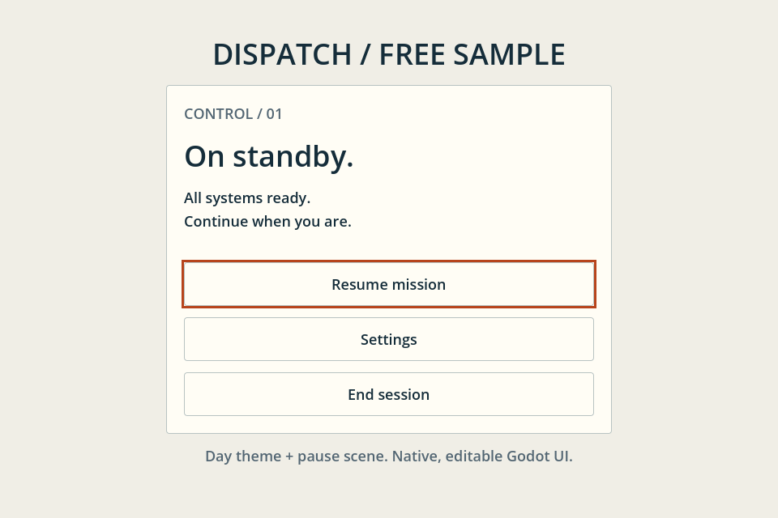

# Dispatch UI — Free Godot Pause Menu

可独立使用的 Godot 原生暂停菜单、日间主题和五枚 SVG 控件图标，附可运行源码。MIT 许可，可商用和修改，保留许可证即可。完整商品在 [itch.io](https://yaotao3000.itch.io/dispatch-ui?utm_source=github&utm_medium=readme&utm_campaign=dispatch-free)。下面提供英文接入说明。

A small, editable pause-menu scene and day Theme for Godot 4.6+, with five SVG control icons and a runnable source project. This free sample works independently. No plugin or additional font files are required.

## Try the sample

[Run the free browser preview](https://yaotao3000.github.io/dispatch-ui-free/) without installing Godot. It runs the actual sample; buttons show their emitted signals. The first load downloads about 40 MB and requires WebAssembly and WebGL 2. For editable source, follow the steps below.

1. Download the source ZIP from Releases and extract it.
2. Import `project.godot` in Godot 4.6 stable or 4.7.2 stable.
3. Press F5. Use Tab / Shift+Tab to move focus and Enter / Space to activate a button. The status text shows the emitted signal.

The buttons emit signals. The sample does not pause, save or exit a game.

## Add the menu to an existing project

1. Copy `dispatch/` into your project as `res://dispatch/`. Keep the paths during the initial import.
2. Set your UI root Control's Theme to `res://dispatch/themes/day.tres`.
3. Instance `res://dispatch/components/pause_menu.tscn` under that root.
4. Connect `resume_requested`, `settings_requested` and `exit_requested` to the behavior owned by your game.
5. Call `focus_first()` after showing the menu if it should receive keyboard focus.

The menu extends `PanelContainer`, so you can place it in your own layout. Keep `dispatch/LICENSE` when copying it into a project. See `sample.gd` for a minimal signal-connection example.

## Compatibility and scope

Verified on macOS / Apple M1 using the Compatibility renderer with Godot 4.6 stable and 4.7.2 stable. Checks cover fresh ZIP import, the sample's focus/signal self-check and actual rendered output. The larger kit also passed clean-project integration and engine-generated keyboard events. The free sample Web preview was also checked in desktop Chrome on the same Mac: all three buttons, Tab / Shift+Tab focus and Enter / Space activation worked through automated native input. These checks do not establish support for Windows, Linux, other browsers, mobile, gamepads or full-kit exported builds. Human physical keyboard input was not separately verified.

The sample uses a 960×640 canvas with canvas scaling. The host game provides pause state, preferences, audio changes, saving and quitting.

## Optional full kit

[Dispatch UI on itch.io](https://yaotao3000.itch.io/dispatch-ui?utm_source=github&utm_medium=readme&utm_campaign=dispatch-free) costs US$4.90 or more. It adds a night Theme, title menu, preferences panel, confirmation dialog, complete showcase and integration guide. You do not need the full kit to use this sample.

## License, provenance and feedback

MIT; copyright 2026 yaotao3000. Commercial use, modification and redistribution are allowed with the included license notice. Code, styling, SVG icons and documentation were made with AI assistance. The preview is actual Godot output. No competitor assets or extra font files are included.

If installation or focus navigation fails, open an issue with your Godot version, operating system, the exact reproduction steps and the relevant error message. Please remove private project data from logs. English and Chinese reports are welcome.
